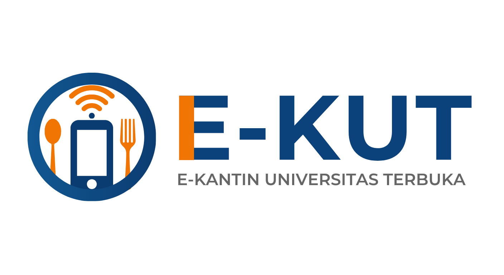

# 🛒 EKUT — E-Kantin UT Self Ordering & CRM System




**EKUT (E-Kantin UT)** merupakan sistem *self-ordering* dan *Customer Relationship Management (CRM)* berbasis web yang dirancang khusus untuk mendukung operasional kantin di lingkungan Universitas Terbuka. Sistem ini mendukung pemesanan mandiri oleh pelanggan, manajemen menu dan pesanan oleh tenant, serta pemantauan pembayaran sewa dan pendapatan harian oleh admin.

Proyek ini dibuat untuk memenuhi syarat **Capstone Project (Mata Kuliah STSI4440)** Program Studi Sistem Informasi, Universitas Terbuka.

---

## 🎯 Latar Belakang & Solusi
Sistem ini dibangun untuk mengatasi masalah operasional di kantin perguruan tinggi, seperti antrean panjang pada jam sibuk, pencatatan manual, serta tidak terkelolanya data riwayat transaksi pelanggan untuk peningkatan layanan kantin. 

**Solusi EKUT:**
- **Pemesanan Mandiri (Self-Ordering):** Pelanggan dapat memesan dari meja melalui ponsel cerdas tanpa perlu mengantre, atau bahkan di luar area kantin dengan pemesanan terjadwal.
- **Pembayaran Digital (QRIS):** Sistem dikembangkan dengan simulasi pembayaran nontunai. Kedepannya, pengembangan dapat dilakukan dengan integrasi pembayaran yang cepat, akurat, dan mencetak struk digital.
- **CRM Terintegrasi:** Membantu tenant menganalisis menu dan riwayat penjualan untuk meningkatkan kualitas layanan. Pembeli juga dapat melihat rating antar tenant dan menu yang telah dipesan.
- **Manajemen Terpusat:** Admin dapat memantau pendapatan seluruh tenant dan status pembayaran sewa.

---

## ✨ Fitur Utama

Sistem ini terdiri oleh 3 aktor utama:

### 👤 Customer (Pelanggan)
- **Scan & Order:** Memindai QR Code untuk langsung mengakses halaman pemesanan.
- **E-Menu & Cart:** Melihat daftar tenant yang aktif, memilih menu, dan mengelola keranjang belanja.
- **Checkout & Payment:** Mengonfirmasi pesanan dan melakukan simulasi pembayaran menggunakan QRIS.
- **Digital Receipt:** Mengunduh struk pembayaran dalam format PDF.

### 🏪 Tenant (Penjual)
- **Order Management:** Menerima pesanan masuk secara *real-time* dan memperbarui status pesanan (*Pending -> Preparing -> Completed*).
- **Menu Management:** Menambah, mengubah, dan menghapus menu beserta harga, stok, dan foto.
- **Sales & CRM Dashboard:** Melihat ringkasan aktivitas toko, riwayat penjualan, dan pendapatan harian berdasarkan filter tanggal.
- **Rental Payment:** Memantau tagihan sewa bulanan dan mengunggah bukti transfer pembayaran sewa.

### 🛡️ Admin (Manajemen Kampus)
- **Tenant Management:** Mendaftarkan tenant baru dan mengubah status operasi tenant (Aktif/Inaktif).
- **Revenue Monitoring:** Memantau ringkasan total pendapatan harian seluruh tenant.
- **Rent Verification:** Memeriksa dan memverifikasi bukti pembayaran sewa dari tenant.
- **Finance & Export:** Menghitung saldo terutang, mengeksekusi transfer pendapatan ke rekening tenant, serta mengekspor laporan transaksi ke format CSV/Excel.

---

## 💻 Penerapan Proyek Menggunakan:

### Frontend
- **React.js** (Antarmuka interaktif)
- **TypeScript** (Arsitektur kode)
- **Vite** (Build tool)

### Backend
- **Node.js** (Runtime JavaScript)
- **Express.js** (Framework REST API)
- **JSON Web Token (JWT)** (Autentikasi dan otorisasi sesi)

### Database & Deployment
- **MySQL** (Database Management System)
- **Aiven (Saat ini) / Cloud SQL Lainnya** (Cloud Database Hosting)
- **Vercel** (Frontend & Backend Deployment)

---

## 📂 Struktur Proyek

```text
EKUT/
├── frontend/           # Kode sumber antarmuka pengguna (React + Vite)
├── backend/            # REST API, logika bisnis, dan konfigurasi server (Node + Express)
├── migration/          # Berkas backup ekspor database (.sql)
├── README.md           # Dokumentasi utama proyek
└── .gitignore          # Daftar file yang diabaikan oleh Git
```

## Panduan Instalasi
Untuk menjalankan proyek ini di lingkungan lokal, ikuti langkah-langkah berikut:

1. Prasyarat
- Node.js (Versi terbaru direkomendasikan)
- MySQL (XAMPP / Laragon / MySQL Workbench)
- Git

2. Kloning Repositori
- `git clone https://github.com/ferify/EKUT.git`
- `cd EKUT`

3. Setup Database
- Buka MySQL Workbench atau phpMyAdmin.
- Buat database baru bernama ekut_db.
- Impor skema database dari file migration/ekut_db.sql.

4. Setup Backend
`cd backend` dan `npm install`

Buat file .env di dalam folder backend/ dan sesuaikan nilainya:
```
DB_CONNECTION=mysql
DB_HOST=127.0.0.1
DB_PORT=3306
DB_NAME=ekut_db
DB_USER=[user]
DB_PASSWORD=[password]

CLOUDINARY_CLOUD_NAME=[cloud_name]
CLOUDINARY_API_KEY=[api_key]
CLOUDINARY_API_SECRET=[api_secret]

JWT_SECRET=[secret]

```
jalankan dengan `npm run dev`

5. Setup Frontend
Buka terminal baru dan jalankan `cd frontend` dan `npm install`

Buat file .env di dalam folder frontend/:
```
VITE_API_URL=http://localhost:3000 (atau link backend lain)
```

jalankan dengan `npm run dev`


## 👥 Tim Pengembang (Kelompok C)
Proyek ini dibangun oleh:
- Anajm Istawa Patsalriyah (049864057)
- Devi Catur Fitriyani (044915318)
- Ferlito Octavius Kurniawan (049059908)
- Himawan Ali (051667935)
- Ovantia Pradevi (051496903)

(Universitas Terbuka - 2026)